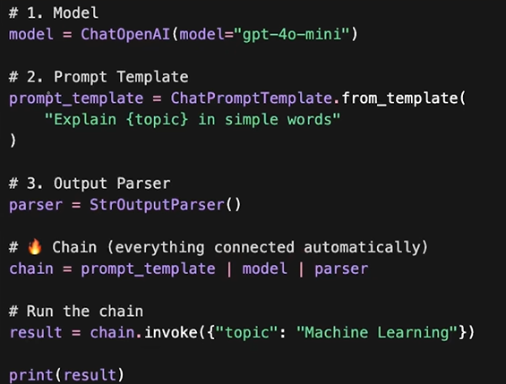

Earlier we need to make seperate components like outputparser, embedding model, llm etc. <strong>Sabko alag alag bana ke alag se connect krna padta tha.</strong> 

Chains solved this issue. <strong>Chain se bahut easy ho jata hai components ko connect krna. </strong>

```python
chain=prompt_template|model|parser (connected together)
result=model.invoke(chain)
```





# Issues faced with Chains

1. No custom logic could be inserted between any 2 steps.
2. No parallel processing between steps.
3. Less control over data flow.

TO SOLVE THESE ISSUES, <strong>"RUNNABLES"</strong> WAS MADE.


Langchain said sab kuch ek runnable hai.

Sabke aage bas .invoke() lagao aur istemal kro 