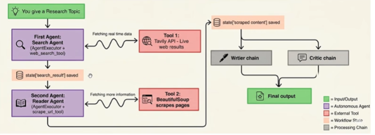

Task-> Research the web for a topic and write a report for that

Solution-> 

We will have four agents:
1. Search Agent [search the information on given topic using **Tavily**]
2. Reader Agent [Extract relevant information using **Beautiful Soup**]
3. Writer Agent [Write report based on relevant information]
4. Critic Agent [Review the final report]